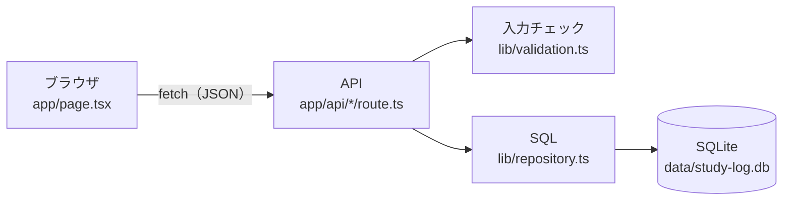

# 学習記録（study-log）

毎日やった勉強を記録して、あとから見返すための小さな Web アプリです。
「今日どれだけやったか」「この1週間、どの科目に時間を使ったか」がひと目でわかります。

## できること
| 機能 | 内容 |
|---|---|
| 記録する | 日付・科目・時間（分）・メモを保存。科目は過去に使ったものから選べる |
| 一覧 | これまでの記録を新しい順に表示・削除 |
| 集計 | 今日の合計、最近7日間の合計、日ごとの棒グラフ、科目ごとの合計 |

## 全体の構成

- 画面は **API を呼んで表示するだけ**。チェック・保存・集計はサーバー側で行います。
- ファイルを役割ごとに分けました。
  - API の入口（`app/api`）：リクエストを受けて、ステータスコードを決める
  - 入力チェック（`lib/validation.ts`）：DB に触らない関数だけなので、テストしやすい
  - SQL（`lib/repository.ts`）：SQL はここにしか書かない。使う DB を引数で受け取るので、テストではメモリ上の DB を渡せる

## API
| メソッド | URL | 内容 | 主なステータス |
|---|---|---|---|
| GET | `/api/logs` | 記録の一覧（新しい順・最大50件） | 200 |
| POST | `/api/logs` | 記録を1件追加 | 201 作成 / 400 入力がおかしい |
| DELETE | `/api/logs/[id]` | 記録を1件削除 | 204 削除 / 400 id がおかしい / 404 ない |
| GET | `/api/stats` | 今日・7日間・日ごと・科目ごとの合計と、科目の候補 | 200 |

POST の例：
```json
{ "studiedOn": "2026-11-01", "subject": "データベース", "minutes": 90, "memo": "正規化を復習" }
```
入力がおかしいときは、だめな理由をまとめて返します。
```json
{ "errors": ["未来の日付は記録できません。", "時間は1〜1440分の整数にしてください。"] }
```

## テーブル設計
| 列 | 型 | 説明 |
|---|---|---|
| `id` | INTEGER | 主キー |
| `studied_on` | TEXT | 勉強した日（YYYY-MM-DD）。**索引あり** |
| `subject` | TEXT | 科目（1〜30文字。`CHECK` 制約） |
| `minutes` | INTEGER | 時間（1〜1440分。`CHECK` 制約） |
| `memo` | TEXT | メモ（空でもよい） |
| `created_at` | TEXT | 保存した日時 |

- 集計は「この期間の記録」を日付で探すので、`studied_on` に索引を付けています。
- 合計は SQL の `SUM` と `GROUP BY` で出します（全件を取り出して JavaScript で足すより速く、数字がずれない）。

## 気をつけたところ
- **チェックはサーバーで必ずする**：画面にも入力制限はありますが、API は直接呼ばれることもあるので、サーバー側で全部確かめます。さらに DB の `CHECK` 制約で二重に守っています。
- **SQL インジェクション対策**：値は `?`（プレースホルダー）で渡し、文字をそのまま SQL につなげません。
- **日本時間で数える**：「今日」はサーバーの時計ではなく日本時間（Asia/Tokyo）で決めます。UTC だと0〜9時が前日扱いになるためです。
- **勉強していない日も 0 で返す**：グラフに穴が空かないよう、7日分を必ずそろえて返します。
- **DB を開きすぎない**：開発中はファイルを保存するたびにコードが読み直されるので、開いた DB を使い回しています。

## 自動テスト
`npm test` で14個のテストが動きます（Node.js 標準の `node:test`）。
| ファイル | 確かめていること |
|---|---|
| `test/validation.test.ts` | 入力チェック（未来の日付、2月30日、小数の分、長すぎる科目など）、日本時間の日付 |
| `test/repository.test.ts` | 追加・一覧・削除、DB の制約、SQL インジェクション風の文字、7日間の集計 |

テストは本物の DB ファイルではなく、メモリ上の一時的な DB を使います。

## 使った技術
- Next.js 16（App Router・Route Handlers）/ TypeScript / React 19
- SQLite（Node.js 標準の `node:sqlite`）
- Tailwind CSS
- テスト：`node:test`

## 動かし方
Node.js 22.13 以上が必要です（テストは 23.6 以上。TypeScript をそのまま動かすため）。
```bash
npm install
npm run dev
```
http://localhost:3000 を開く。データは `data/study-log.db` に保存されます。

```bash
npm test
```

## これからやりたいこと
- ログインを付けて、自分の記録だけが見えるようにする
- インターネットに公開する（そのときは DB を PostgreSQL に移す）
- 目標時間を決めて、達成できたかを表示する
